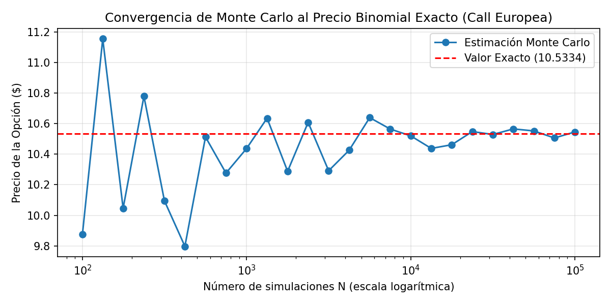
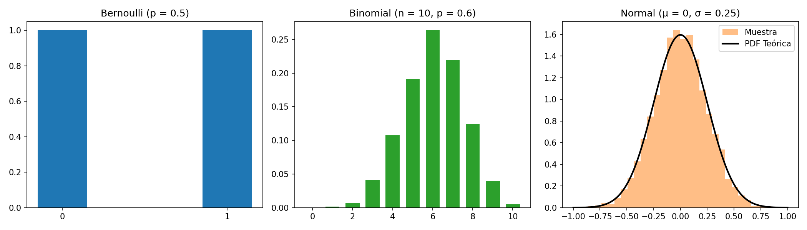

# Valuación Cuantitativa de Opciones Financieras: Modelo Binomial y Monte Carlo Vectorizado

Implementación en Python de modelos de valuación de derivados financieros, contrastando soluciones analíticas exactas bajo medida neutral al riesgo frente a simulaciones estocásticas de Monte Carlo vectorizadas con intervalos de confianza, programación dinámica y calibración numérica.

## Resumen del Proyecto

1. **Simulación de Variables Aleatorias:** Generación y validación visual de distribuciones Bernoulli, Binomial y Gaussiana mediante `scipy.stats`.
2. **Opciones Europeas (*Call* y *Put* en $M$ períodos):**
   * Valuación analítica exacta mediante la esperanza descontada bajo probabilidad neutral al riesgo.
   * Simulación de Monte Carlo vectorizada con estimación de error estándar e intervalos de confianza al 95 %, incluyendo análisis de convergencia al aumentar el número de trayectorias $N$.
3. **Opciones Exóticas Dependientes de la Trayectoria (*Path-Dependent*):**
   * **Opción Asiática (*Asian Call*):** Valuación basada en el promedio aritmético del activo subyacente a lo largo de la trayectoria simulada.
   * **Opción Barrera (*Up-and-Out Call*):** Simulación de cancelación anticipada (*knock-out*) cuando el subyacente supera el umbral $B$ antes del vencimiento.
4. **Opciones Americanas (*American Put*):** Valuación mediante inducción hacia atrás (*backward induction*) en el árbol binomial para determinar la política óptima de ejercicio anticipado.
5. **Calibración No Lineal y Extracción de Datos:**
   * Ajuste de parámetros mediante `scipy.optimize.least_squares` proporcionando el **jacobiano analítico** explícito para acelerar la convergencia.
   * Módulo de extracción estructurada de cadenas de opciones desde Yahoo! Finance (`requests` + `BeautifulSoup`).

## Visualizaciones

## Stack Técnico
* **Lenguaje:** Python 3
* **Cómputo Científico:** NumPy (operaciones vectorizadas), SciPy (`stats`, `optimize`)
* **Visualización y Datos:** Matplotlib, Pandas, BeautifulSoup4
